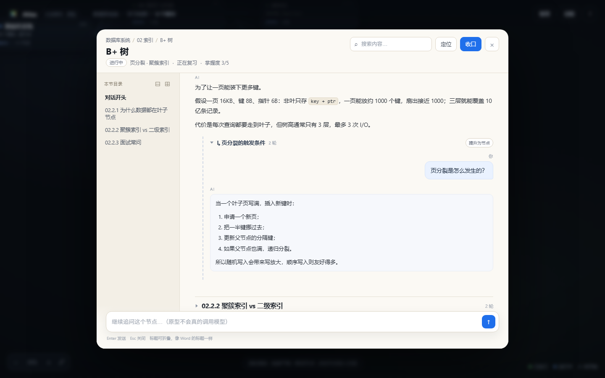

# DSH-Atlas

> 把对话长成一张地图。
> A spatial workspace for long conversations.

[](LICENSE)
[](https://github.com/deepseek-ai/deepseek-harness)
[](#roadmap)

DSH-Atlas 是 **DeepSeek Harness** 的插件（开发中）：把线性对话变成一张**可缩放的任务地图**。

- 每个节点是一段对话，画布表达任务结构；
- 点开节点，相机飞入并打开对话；
- 对话内的标题可以折叠成**子聊天**，像 Word 的标题一样；
- 关闭节点时生成**收口卡**，下次打开先给**续接简报**；
- 画布同时是复习地图：绿色=已收口，蓝色=进行中，灰色=未开始。

一句话：**树负责结构，栈负责当下，列表负责回访。**

> 先看交互原型：[`docs/prototype.html`](docs/prototype.html)（单文件、零依赖，直接双击打开）。


## 为什么做 Atlas

线性聊天把“一层一层的任务”压成了一条时间线：

- 想知道“这个知识点属于哪个模块”，只能翻历史；
- 想深入一个子问题，只能新开窗口，回来时上下文已经丢了；
- 关掉窗口就“失忆”，几天后要重读几十条消息。

Atlas 把结构还给对话：**画布管广度，节点管模块，标题管子问题**。超过三层就“提升为节点”，把深度换成广度。

## 特性（目标）

- **无限画布**：pan / zoom / 拖拽节点 / 适配视图；语义缩放，远看是标题，近看是卡片。
- **节点即对话**：点节点进入对话，关闭回到画布原位；相机位置保留。
- **Word 式标题**：对话内的标题可折叠、可搜索、有目录轨；标题下可以再开子聊天。
- **收口卡**：关闭节点时生成结论 / 未解问题 / 掌握度 / 衔接句；可追溯消息范围。
- **续接简报**：重新打开时先告诉你“上次停在哪、还有什么没解决”。
- **提升为节点**：把子聊天变成画布子节点，控制嵌套深度。
- **本地优先**：工作区在 `~/.dsh/atlas`，可导出、可迁移；除模型 provider 外不发网络请求。
- **复习**（M4）：收口卡生成问答卡，FSRS 排期，画布就是复习地图。




## 安装

> **早期开发中**：目前只有静态原型，插件尚未发布到 npm。下面是目标安装方式。

```bash
dsh plugin --profile web add dsh-atlas
```

从源码安装：

```bash
git clone https://github.com/<you>/dsh-atlas.git
cd dsh-atlas
pnpm install
pnpm run check
dsh plugin --profile web add .
```

要求：DeepSeek Harness `0.1.x`、Node.js 22.19+、pnpm。

## 快速开始（目标体验）

1. 新建工作区，输入目标，例如“八周内过一遍数据库的八个模块”。
2. 让模型给出 8 个模块，确认后生成 8 个节点。
3. 点“02 索引”，进入对话；在 B+ 树的回答里点“展开”，出现子聊天“页分裂”。
4. 问完后点“收口”，生成 3 条结论和 2 个未解问题。
5. 点“提升为节点”，页分裂成为画布上的子节点。
6. 一周后打开 Atlas，节点显示“3 轮 · 掌握 3/5”；点开先看续接简报。

## 工作原理

```
L0 画布   任务地图（数据库 8 个模块）
L1 节点   模块对话（02 索引 → B+ 树）
L2 标题   子问题（页分裂 / 聚簇索引）
L3+       不再嵌套，改为「提升为节点」
```

- 画布负责**广度**，节点内标题负责**深度**。
- 每个节点是一个独立的上下文边界：祖先只传收口卡，不传 transcript。
- 子聊天只带“路径卡 + 父线程摘要 + 选中引用”，不带整棵树。
- 关闭不是删除，是**收口**：生成一张卡，成为节点在树里的“脸”。

完整设计见 **[docs/design.md](docs/design.md)**。

## Roadmap

- [x] **M0** 静态原型：画布 / 对话 / 子聊天 / 收口（[`docs/prototype.html`](docs/prototype.html)，截图在 `docs/assets`）
- [ ] **M1** 插件骨架 + 工作区 + 画布 + 节点 CRUD
- [ ] **M2** 对话面板 + Atlas-native 线程 + SSE + 收口
- [ ] **M3** 子聊天 + 引用 + 提升 + 搜索
- [ ] **M4** 复习（FSRS）+ 导出/导入
- [ ] **M5** Agent mode（绑定 DSH session）+ 原生对话 portal
- [ ] **M6** 开源发布：文档、demo、CI

## 开发

> 当前是 M0：仓库只有设计文档、原型和截图。下面的命令在 M1 落地后可用。

```bash
pnpm install
pnpm run check      # lint + typecheck + test + build
pnpm run dev        # 开发模式
```

仓库结构见 [docs/design.md §4.2](docs/design.md)。

## 贡献

欢迎 issue、PR、设计讨论。提交 PR 前请先跑 `pnpm run check`。
如果你在做类似的画布/对话树工具，也欢迎来交流。

## License

[MIT](LICENSE)

## Disclaimer

Atlas 是独立的开源项目，与 MongoDB Atlas、Atlas Copco 等无关联。
“Atlas” 是常见英文词；如果你要商业发行，请自行做商标检索。
