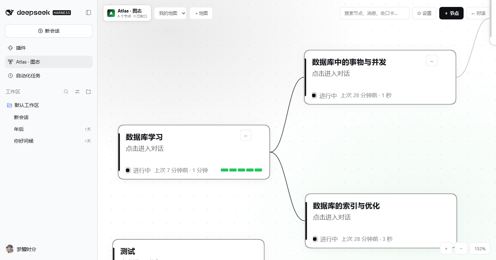
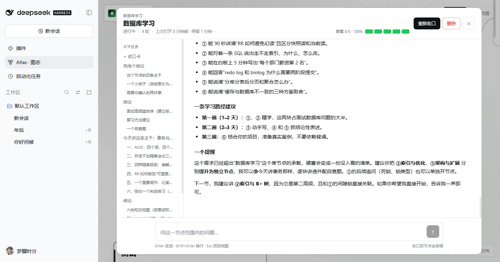
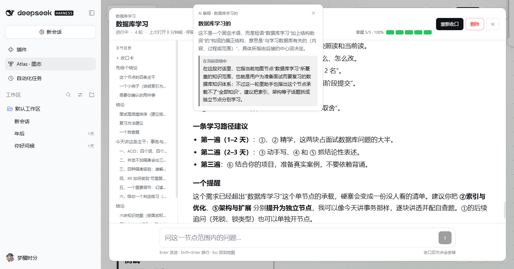
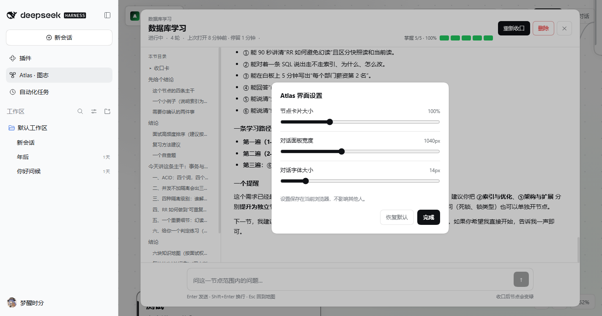
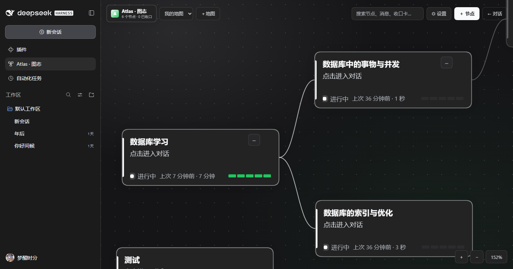

# DSH-Atlas

> 把对话长成一张地图。  
> A spatial workspace for long conversations.

[](LICENSE)
[](https://github.com/deepseek-ai/deepseek-harness)
[](#roadmap)

---

## 你是否也遇到过这些时刻？

- 处理一个长任务时，同时开了好几个侧边聊天框，最后分不清哪条在讲什么；
- 想回到三天前某个结论，只能在一长串消息里反复往上翻；
- 一个问题聊到一半，想单独深挖某个子问题，又怕把主线聊乱；
- 聊完就忘，下次打开只记得“好像聊过”，却想不起聊到了哪；
- 本地攒了很多聊天记录，却没有一个真正好用的地方去回看和整理。

**DSH-Atlas 就是为这些问题做的。**

它是 **DeepSeek Harness** 的一个插件：把一条越聊越长的对话，变成一张可以缩放、拖动、随时回看的 **任务地图**。

每一个节点是一段独立对话；节点之间用连线表达结构；点开节点，就像翻开一页纸，继续聊、做分支、收口、复习。你不再需要靠记忆维护上下文，也不需要开十几个侧边栏。

---

## Atlas 是什么

一句话：**把线性的聊天，整理成可回访的空间。**

```
L0 画布   任务地图（例如：数据库 8 个模块）
L1 节点   模块对话（02 索引 → B+ 树）
L2 标题   子问题（页分裂 / 聚簇索引）
L3+       不再嵌套，改为「提升为节点」
```

- **画布负责广度**：所有任务一眼看清；
- **节点内标题负责深度**：一个话题内部继续展开；
- **收口卡负责回访**：关闭节点不是删除，而是把这段对话压缩成一张可再次打开的卡。



*画布：节点结构、上次打开时间与掌握度颜色段，一眼看清当前地图。*

---

## 功能一览

| 功能 | 你能得到什么 |
|---|---|
| **任务地图** | 无限画布，平移、缩放、拖拽、适配；节点多也不会乱 |
| **一节点一对话** | 每个节点有独立上下文，互不污染 |
| **收口卡** | 关闭节点时生成结论、要点、未解问题与掌握度 |
| **续接简报** | 再次打开已收口节点，先看上次聊到哪，再决定是否继续 |
| **子聊天** | 从任意回答「分支」出一个子问题，聊完可「提升为节点」 |
| **卡片记忆** | 卡片显示上次打开时间与停留时长，知道哪些内容最近碰过 |
| **掌握度** | 5 段颜色条记录 0–5 级；对话头部可点击并显示百分比 |
| **选中解释** | 鼠标选中对话里的词或句子，自动结合当前上下文解释 |
| **全局搜索** | 同时搜索节点、消息与收口卡 |
| **界面设置** | 卡片大小、对话面板宽度、对话字号都能调 |
| **深浅色主题** | 跟随 DSH 的亮色/暗色配色与字体 token |
| **本地优先** | 工作区存在 `~/.dsh/atlas`，不依赖云端账号 |

### 对话与收口



*纸张式对话：目录轨、流式回答、掌握度与收口入口都在同一页。*

### 选中解释与界面设置

<p align="center">
  
  
</p>

*左侧：选中文字，结合节点与最近对话解释；右侧：调整卡片大小、对话宽度与字号。*

### 亮色与暗色



*暗色主题跟随 DSH 的配色 token，画布、卡片、对话面板自动切换。*

---

## 5 分钟上手

1. 安装插件并打开 DSH Web（见下方「安装」）。
2. 左侧边栏出现 **Atlas · 图志**，点进去。
3. 输入第一个模块，例如「02 索引」。
4. 点击节点，问：「B+ 树为什么把数据放在叶子节点？」。
5. 回答下方点「分支」，把「页分裂」展开成子聊天。
6. 子聊天里继续追问，再点「提升为节点」，画布上就多了一个子节点。
7. 回到主节点，点右上角「收口」；节点变绿，生成结论、要点、未解问题与掌握度。
8. 再次打开该节点，先看到续接简报；点「重新打开」即可继续追问。
9. 在对话里选中一个词，松手后会弹出「AI 解释」，同时给出通用含义和当前语境下的含义。
10. 顶栏「⚙ 设置」可调整卡片大小、对话面板宽度与字号。

### 一个典型工作流

```
新建「数据库」根节点
  → 聊「事务与并发」
  → 分支「MVCC 是什么」
  → 提升为子节点
  → 收口「事务与并发」，得到一张结论卡
  → 一周后打开，先看续接简报，再决定复习还是继续
```

---

## 核心设计原则

Atlas 不是“另一个聊天客户端”，它首先是一张**地图**。几条原则决定了它的形态：

### 1. 设计灵感：把书读厚，再把书读薄

> **学习是把书读厚，再把书读薄的过程。**

Atlas 把这句话变成了产品结构：

- **读厚**：在一个节点里继续追问、分支、展开细节，让问题充分长开；
- **读薄**：收口时把这段对话压成结论、要点、未解问题与掌握度；
- **重新翻开**：许多张收口卡按结构摆在画布上，随时可以回到任何一章。

地图不是为了收藏更多内容，而是为了让“读厚”之后还能“读薄”，并且薄下来之后仍然找得回去。

### 2. 树负责结构，栈负责当下，列表负责回访

- **树**：节点之间的父子关系，表达任务结构；
- **栈**：当前打开的对话，只处理眼前这一段；
- **列表**：搜索、收口卡、最近打开，负责回头找东西。

三者各司其职，不把所有信息塞进同一条无限长的消息流。

### 3. 关闭不是删除，而是收口

「收口」是把一段对话压缩成一张卡：结论、要点、未解问题、掌握度。

- 对话内容仍然保留；
- 节点在画布上变为已收口状态；
- 下次打开先看续接简报，而不是重新读完整 transcript。

### 4. 节点边界是硬边界

每个节点是一段独立上下文。祖先节点只向子节点传递收口卡，不传完整聊天记录。这样：

- 单个节点的上下文不会无限膨胀；
- 子节点不会被父节点的历史细节淹没；
- 提升为节点时，子聊天复制自己的消息与引用，父节点只保留一条关系。

### 5. 本地优先，网络请求可控

工作区数据保存在本机 `~/.dsh/atlas`。除了模型 provider 与可关闭的 GitHub 版本检查，插件不主动发出网络请求。

### 6. 先让地图可用，再让地图聪明

复习算法、自动布局、Agent mode 都建立在地图结构稳定之后。当前版本优先保证：**建得出来、聊得下去、收得回来、找得到。**

---

## 安装

需要：

- DeepSeek Harness `0.2.x`（在 `0.2.1-rc.2` 上实测）；
- Node.js `22.19+`；
- `pnpm` 在 PATH 中（DSH 插件管理器依赖它）。

```bash
# 推荐：直接从 GitHub 安装
dsh plugin --profile web add github:nononeundertsand/DSH-Atlas

# 启动 DSH Web
dsh web
```

打开 DSH Web 后，左侧边栏会出现 **Atlas · 图志**。
也可以直接访问 `http://127.0.0.1:<port>/#atlas`。

> 如果本机还没有 `dsh` 命令，可先安装：
> `npm install -g @deepseek-ai/dsh@0.2.1-rc.2`。
> DSH 仍处于 developer preview，插件 API 可能随版本变化。

---

## 更新

DSH 的插件管理器不会自动拉取 Git 更新。Atlas 内置了轻量版本检测：

- Host 每 6 小时读取一次 GitHub 上的 `package.json` 版本；
- 顶栏出现 `↑ vX.Y.Z` 表示有新版本；
- 检测只提示，不自动替换正在运行的 Host 代码；
- 可用 `checkUpdates: false` 关闭检测。

更新步骤：

```bash
dsh plugin --profile web update dsh-atlas
dsh web
```

如果 pnpm 没有重新解析 Git 依赖，重新 add 一次：

```bash
dsh plugin --profile web add github:nononeundertsand/DSH-Atlas
```

> 发布新版本时必须提升 `package.json` 的 `version`，否则检测不会认为有新版本。

---

## 常见问题

**数据存在哪里？**  
`~/.dsh/atlas/workspaces/<workspace-id>/`，按工作区存放节点、线程、消息与收口卡。

**收口会删除聊天吗？**  
不会。收口只是生成一张总结卡并把节点标记为已收口，原始消息仍然保留。

**为什么点击节点没有跳转页面？**  
Atlas 使用“纸张式”对话面板，画布保留在背景原位，方便随时回到地图。

**没有可用模型怎么办？**  
画布、节点、搜索和本地存储仍可使用；对话与收口会返回明确的 `E_AUTH` / `E_MODEL` 错误。

**选中解释依赖什么？**  
依赖 DSH 当前可用的模型。选中文字后，Atlas 会把节点、最近对话与选中内容一起交给模型。

---

## 可选配置

在 profile 的 `cordis.patch.yml` 中覆盖默认模型、数据目录或更新检测：

```yaml
- id: atlas
  config:
    provider: deepseek-official
    model: deepseek-flash
    # dataDir: D:/atlas-data
    # maxTokens: 1600
    # checkUpdates: false
    # updateRepo: nononeundertsand/DSH-Atlas
```

不填 `provider` / `model` 时，Atlas 会自动选择第一个可用 provider 的模型。

---

## 技术架构

> 以下内容面向开发与二次开发；普通用户读完上面的「功能」「安装」「更新」即可使用。

```
dsh-atlas/
├─ cordis.patch.yml        # 单包插件注册（Host + 浏览器半）
├─ package.json            # dsh.bundle / dsh.client 声明
├─ scripts/build.mjs       # esbuild：Host ESM + 浏览器 __ModuleLoader__ 包装
├─ src/
│  ├─ host/
│  │  ├─ index.ts          # 插件入口、配置、路由注册
│  │  ├─ routes.ts         # /ext/atlas/*、JSON、SSE、选中解释
│  │  ├─ store.ts          # 工作区/节点/线程/消息/卡片/访问记录
│  │  ├─ context.ts        # 上下文组装、预算裁剪、解释上下文
│  │  ├─ closure.ts        # 收口卡生成、校验、降级
│  │  ├─ actions.ts        # 提升为节点
│  │  ├─ model.ts          # LlmPort 适配：路由选择、流式、JSON
│  │  └─ update.ts         # GitHub 版本检测
│  ├─ client/
│  │  ├─ index.tsx         # 注册 main 面板与 sidebar.panellist 图标
│  │  ├─ AtlasApp.tsx      # 主面板、工作区、搜索、设置
│  │  ├─ Canvas.tsx        # 相机、平移缩放、拖拽、边、LOD、子树收起
│  │  ├─ ChatSheet.tsx     # 对话、目录轨、收口卡、子聊天、选中解释
│  │  ├─ Mastery.tsx       # 掌握度颜色段与百分比
│  │  ├─ format.ts         # 相对时间、时长、卡片记忆文案
│  │  ├─ settings.ts       # 浏览器端界面设置
│  │  ├─ api.ts            # HTTP + SSE 客户端
│  │  ├─ markdown.tsx      # 轻量 Markdown 与标题提取
│  │  └─ styles.ts         # 作用域化 CSS
│  └─ shared/
│     ├─ types.ts          # 领域类型
│     ├─ protocol.ts       # 路由与限制
│     └─ dsh.ts            # DSH 适配端口（webServer / llm / slots）
├─ tests/smoke.mjs         # 真实 HTTP + SSE 的端到端冒烟
└─ docs/
```

### 本地存储

```
~/.dsh/atlas/workspaces/<workspace-id>/
  workspace.json           # 元数据、目标、rev
  nodes.json               # 节点、位置、掌握度、上次打开与停留
  threads.json             # 主线程与子聊天元数据
  viewport.json            # 相机
  threads/<thread-id>.jsonl # 追加写消息
  cards/<node-id>.json     # 收口卡
```

整文件写入使用 `write temp → rename`；消息追加写；单进程内用 Promise 队列串行化写操作。

### HTTP 与 SSE

所有请求走同源 `/ext/atlas/*`，由 DSH `webServer` 承载：

- `GET /bootstrap`：工作区列表与当前快照；
- `GET /update`：GitHub 版本检测；
- `POST /nodes`、`PATCH /nodes/:id`、`DELETE /nodes/:id`；
- `POST /nodes/:id/close`：收口；
- `POST /nodes/:id/visit`：记录上次打开时间与停留时长；
- `GET /threads/:id`：线程、消息、卡片、路径、子聊天；
- `POST /threads/:id/turn`：SSE（`meta → delta* → done/error`）；
- `POST /threads/:id/explain`：结合上下文解释选中文字；
- `POST /threads/:id/promote`：提升为节点；
- `GET /search?q=`：节点、消息、卡片搜索。

SSE 事件顺序固定为 `meta → delta* → done/error`。页面刷新后会重新拉取完整线程，暂不支持断线续传。

---

## 开发

```bash
npm install
npm run typecheck    # TypeScript
npm run build        # lib/host/index.js + lib/client.js
npm run smoke        # 端到端冒烟
npm run check        # 三者一起跑
npm run dev          # Host watch（客户端改动后需再跑一次 build）
```

`lib/` 是构建产物。为了让 `dsh plugin add github:owner/repo` 对其他人直接可用，仓库会保留构建后的 `lib/`；修改源码后请运行 `npm run build`，并提交更新后的 `lib/`。

### 浏览器插件协议

- `package.json` 的 `dsh.client` 声明平台与依赖顺序；
- `lib/client.js` 由 esbuild 打成 CJS，再包进 `window.__ModuleLoader__.load({ id, factory })`；
- React、`react/jsx-runtime`、`@deepseek-ai/dsh-client-ui-*` 等由 DSH 平台模块表提供，不打进 bundle；
- 面板注册在 `main` 的 `atlas` key，侧边栏图标注册在 `sidebar.panellist`。

### 从源码安装

```bash
git clone https://github.com/nononeundertsand/DSH-Atlas.git
cd DSH-Atlas
npm install
npm run check
dsh plugin --profile web add .
dsh web
```

---

## 兼容性

- 目标版本：DeepSeek Harness `0.2.x`（在 `0.2.1-rc.2` 的插件约定上实现）。
- DSH `0.1.x` 的 slot 名称、SSE 与模型 API 可能不同；如需兼容旧版，应在 [`src/shared/dsh.ts`](src/shared/dsh.ts) 适配层中补端口，而不是改业务代码。
- 能力缺失时：
  - 无 `llm`：Host 插件等待该服务；对话返回明确错误，画布仍可使用；
  - 无 `webServer`：插件不会加载（Atlas 需要 HTTP 路由）；
  - 无 `layout` / `slots`：浏览器半不会挂载。

---

## Roadmap

- [x] **M0** 静态原型
- [x] **M1** 插件骨架 + 工作区 + 画布 + 节点 CRUD
- [x] **M2** 对话面板 + Atlas-native 线程 + SSE + 收口
- [x] **M3（基础版）** 子聊天 + 引用 + 提升 + 搜索
- [x] **M4** 体验增强：掌握度、卡片记忆、界面设置、选中解释
- [ ] **M5** 复习（FSRS）+ 导出/导入
- [ ] **M6** Agent mode（绑定 DSH session）+ 原生对话 portal
- [ ] **M7** 开源发布：CI、截图回归、npm 发布

---

## 已知限制（MVP 有意收敛）

- 标题目前生成**目录轨**，尚未实现“标题折叠为子聊天块”；子聊天从回答的「分支」按钮创建。
- 子聊天只有一层；更深层请「提升为节点」。
- 画布上的“收起子树”按工作区保存在浏览器 localStorage，不写入工作区文件。
- Markdown 渲染器覆盖标题、列表、引用、代码块与行内强调，不包含表格、脚注、数学公式。
- SSE 不支持断线续传；页面刷新后会重新拉取完整线程。
- 收口卡由模型生成；模型不可用时降级为基于最近回答的手动卡。
- 选中解释依赖当前模型；长文本会被截断到 200 字以内。
- 暂不支持多用户、CRDT、移动端。
- 搜索为本地逐条匹配，面向 10k 消息以内；更大规模需要索引。

---

## 隐私与安全

- **本地优先**：工作区存储在 `~/.dsh/atlas`；除模型 provider 与可关闭的 GitHub 版本检查外，不发网络请求。
- **不遥测**：插件不采集消息内容；日志只打印工作区路径。
- **路由边界**：`/ext/atlas/*` 不带额外鉴权，默认只在 DSH 的 loopback 监听下使用。若把 DSH 绑定到非回环地址，请在前面加反向代理鉴权。
- **Markdown**：使用自绘渲染器，不执行内联脚本、iframe 或事件属性。
- **模型上下文**：祖先节点只发送收口卡；节点边界是硬边界，不跨节点压缩。

---

## 贡献

提交 PR 前请确保 `npm run check` 通过。设计层面的讨论请通过 Issue 提交。

## 许可证

[MIT](LICENSE)

## Disclaimer

“Atlas” 是常见词，本项目与 MongoDB Atlas、Atlas Copco 等无任何关联。
