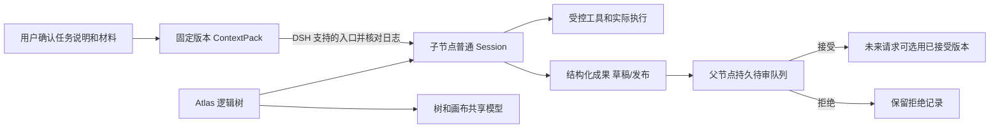

# Atlas 向真实 Session 任务树演进：第一轮审查

审查基准：Atlas `e41b5d793dd422d0e785c4a975bbcab375c46805`，包版本 `0.1.3`；本机 DeepSeek Harness Desktop 的 `CFBundleShortVersionString` 为 `0.2.1-rc.2`。桌面 profile 的锁文件指向相同 Atlas commit，Host bundle SHA-256 与仓库产物相同。进程存在和安装匹配不等于真实交互验收。DSH 源码按 rc.2 release commit [`687f282e8625c6b8d11ff58211a90524be2e4317`](https://github.com/deepseek-ai/deepseek-harness/tree/687f282e8625c6b8d11ff58211a90524be2e4317) 检查；官方标签指向该 commit；此前发现另一个同标版本号的提交 d1b9c040，本文引用的关键文件与官方标签逐文件一致。桌面二进制与源码的逐文件构建一致性未验证。旧报告 rc.3 仅作线索。

证据标签：**源码确认**=静态阅读；**测试确认**=测试确实运行且说明范围；**运行确认**=真实进程/交互实际观察；**尚未验证**=不能推断结果。

## 目标与决定

通用多层逻辑任务树，每个正式节点对应一个可独立运行与恢复的普通 DSH Session。逻辑父子边不等于 runtime ownership、Fork 来源、读权限或文件权限。左侧 Atlas 树，右侧尽可能复用原生聊天；现有画布保留为可切换视图，与树共享节点模型。学习功能按场景可选。用户已选：首个闭环包含受控工具调用；子任务默认只接收用户确认的任务说明及所选材料；Atlas 树是主要入口，研究如何避免重复导航。实现细节和安全边界尚待验证。

## 当前调用链与证据

| 部分 | 现状与证据 | 证据级别 |
|---|---|---|
| 加载 | [host/index.ts](../src/host/index.ts) `apply` 注册 `/ext/atlas`，构建 `AtlasStore`、`AtlasModel`；[client/index.tsx](../src/client/index.tsx) 注册 main 的 `atlas` 面板与侧栏图标 | 源码确认 |
| 创建 | [store.ts:167](../src/host/store.ts#L167) `createNode` 新建 Atlas Node 与主 Thread；[store.ts:309](../src/host/store.ts#L309) 子线程绑定节点主 Thread | 源码确认 |
| 发送 | [routes.ts:257](../src/host/routes.ts#L257) `turn` 写用户消息、组装上下文、预写空 assistant、调用 `AtlasModel.run`，SSE 推送，再写最终内容；[model.ts:34](../src/host/model.ts#L34) 调用 `llm.stream`，不是 Agent tool loop | 源码确认 |
| 恢复与日志 | [store.ts:341](../src/host/store.ts#L341) JSONL 存 Atlas 消息；[store.ts:485](../src/host/store.ts#L485) 读取。没有绑定 Session、工具事件或原生会话恢复；进程中途退出可能留下空 assistant，未验证修复 | 源码确认；崩溃表现尚未验证 |
| UI 订阅 | [client/api.ts](../src/client/api.ts) 消费 Atlas HTTP/SSE；[ChatSheet.tsx](../src/client/ChatSheet.tsx) 自绘消息、目录与子聊天，不消费原生 Session 事件流 | 源码确认 |
| 收口 | [closure.ts:24](../src/host/closure.ts#L24) 生成或 fallback，随后 [store.ts:387](../src/host/store.ts#L387) 保存卡并将节点置 closed。关闭面板本身只是 [AtlasApp.tsx:128](../src/client/AtlasApp.tsx#L128) 清掉当前 Thread | 源码确认 |
| 现有测试 | [tests/smoke.mjs:15](../tests/smoke.mjs#L15) 临时目录、假 LLM、loopback HTTP；上一轮运行 `npm run check`，typecheck/build/smoke 通过；测试结束删除临时目录。构建只产生可恢复构建文件，本轮开始工作树干净 | 测试确认；非真实 DSH、真实模型或浏览器测试 |
| 本机 | Desktop app 进程存在，Info.plist 为 rc.2；桌面 profile 锁定 Atlas 当前 commit | 运行确认仅限版本/进程/安装元数据；未操作现有应用和真实会话 |

## README、设计、源码和行为差距

| 需求或声明 | 当前实现与差异 | 建议 / 优先级 |
|---|---|---|
| 真 Session 为核心 | README [路线图](../README.md#L372) 把绑定 Session 放 M6；[设计文档](design.md#L295) 以 Atlas-native 为主且 M5 才绑定；源码无 Session adapter | 提前作为正式节点的主模型；旧 Thread 归档保留。P0 |
| 多层同等子 Session | 节点可直接创建子节点且 `parentId` 可多层，但主线程都是 Atlas-native；一级 subthread 固定指向主线程 [store.ts:309](../src/host/store.ts#L309)，提升时复制消息 [actions.ts:27](../src/host/actions.ts#L27) | 直接建立同类正式节点，分支/提升作为旧数据兼容。P0 |
| 父子上下文需授权 | [context.ts:38](../src/host/context.ts#L38) 自动带所有祖先标题和卡片 tldr；子聊天自动带父线程最后两条**消息**，不是注释中的两轮 [routes.ts:268](../src/host/routes.ts#L268) | 固定授权包，未选内容不传。P0 |
| 版本与并发 | [设计](design.md#L469) 设想 clientRev、409、文件锁；[store.ts:136](../src/host/store.ts#L136) 有 rev，但未见写请求 CAS；单进程全局队列 [store.ts:536](../src/host/store.ts#L536)，无跨进程文件锁 | 增加操作级 CAS、事务/日志与恢复；P0，跨进程方案需专门测试 |
| Token 预算和压缩 | [设计](design.md#L507) 列 token 预算及滚动摘要；[context.ts:31](../src/host/context.ts#L31) 用 24,000 字符和最近 12 条消息；[trimMessages](../src/host/context.ts#L144) 保留至少一条，因此单条也可超预算，引用和 system 不计入 | 模型窗口感知的预算 + 实际 request 审计；P0 |
| 收口来源 | [closure.ts:69](../src/host/closure.ts#L69) sourceRange 指全部消息头尾，实际摘要只使用裁剪后的最多 30 条 [context.ts:87](../src/host/context.ts#L87)，不能精确说明模型见过哪些消息；模型失败也保存 fallback 并 closed | 把实际输入来源与生成方式保存；摘要发布和任务完成解耦。P0 |
| 关闭与继续 | 界面返回画布与收口分开；但收口保存强制 closed，直接发送会改 active [routes.ts:262](../src/host/routes.ts#L262)。不存在独立的暂停任务/完成/成果审核机制 | 面板、停止、暂停、完成、归档、发布分离；完成后仍可发起后续任务或交互。P0 |
| UI 与运行时 | Atlas 有画布、ChatSheet；DSH `main` 的 `conversation` 是原生 Session 面板，非 conversation key 无 Session binding；见 [ui-layout](https://github.com/deepseek-ai/deepseek-harness/blob/687f282e8625c6b8d11ff58211a90524be2e4317/packages/client/ui-layout/src/client/index.ts#L69-L73)、[ui-conversation](https://github.com/deepseek-ai/deepseek-harness/blob/687f282e8625c6b8d11ff58211a90524be2e4317/packages/client/ui-conversation/src/client/apply.ts#L560-L570) | 原生聊天优先；Atlas 树选择 Session，避免两套主导航，画布保留。slot 实际组合尚需浏览器验证。P0 |
| 文档版本 | README 称 rc.2 实测 [README:168](../README.md#L168)；设计仍写 0.1.x [design:280](design.md#L280)、[design:727](design.md#L727)，其能力探测和 sessionFork 方案非已实现 | 更新设计状态标记，不把旧计划当现状。P1 |
| 搜索和学习 | 搜索节点标题、副标题、消息和卡片，但未搜索线程标题 [store.ts:412](../src/host/store.ts#L412)，与 [设计](design.md#L687) 不同；复习为路线图；掌握度和选中解释存在 | 保留已有数据；学习能力可选，复习延后；通用 UI 不默认显示掌握度。P1/P2 |
| 测试 | [设计](design.md#L748) 设想单元、集成、浏览器、golden；目前仓库只有 smoke。SSE 出错会发 error 后再发 done [routes.ts:311](../src/host/routes.ts#L311)，README 的 `done/error` 描述不精确 | 先补风险导向测试；避免把 fake 结果当真实集成。P0 |
| 收口卡编辑 | [设计](design.md#L193) 写保存前可编辑；现实现直接生成并保存，未发现编辑接口 | 后续支持草稿与明确发布；不应静默更改成果。P1 |

## DSH rc.2 集成点与边界

1. **创建和恢复**：[SessionCommands.create](https://github.com/deepseek-ai/deepseek-harness/blob/687f282e8625c6b8d11ff58211a90524be2e4317/packages/api/session-controller/src/commands.ts#L105-L149) 创建普通 Session，接受 workspaceId 或 cwd 及 preset；[createAgent](https://github.com/deepseek-ai/deepseek-harness/blob/687f282e8625c6b8d11ff58211a90524be2e4317/packages/api/session-controller/src/agent.ts#L559-L577) 使用 `ctx.agents.create`。普通恢复入口重新应用 preset composition，调用 `ctx.agents.resume` [agent.ts:424](https://github.com/deepseek-ai/deepseek-harness/blob/687f282e8625c6b8d11ff58211a90524be2e4317/packages/api/session-controller/src/agent.ts#L424-L444)。源码支持独立恢复的判断；本轮未在匹配运行时实测 Root 释放及重启。
2. **所有权**：[agent-loop prepare](https://github.com/deepseek-ai/deepseek-harness/blob/687f282e8625c6b8d11ff58211a90524be2e4317/packages/core/agent-loop/src/index.ts#L590-L615) 把生命周期挂到调用方 `ownerCtx`；`parentAgent` 表示另一个运行时关系。即使不传 parentAgent，如果用短命父节点 scope 发起，owner 销毁仍会释放 Agent。应通过长寿命 Host scope 创建和恢复，不设置 `origin: 'subagent'`；API 对 subagent ownership 有拒绝 [agent.ts:110](https://github.com/deepseek-ai/deepseek-harness/blob/687f282e8625c6b8d11ff58211a90524be2e4317/packages/api/session-controller/src/agent.ts#L110-L119)。插件卸载后对象归属和策略不能仅靠存活中的回调，见下文。
3. **Fork**：[buildForkSeed](https://github.com/deepseek-ai/deepseek-harness/blob/687f282e8625c6b8d11ff58211a90524be2e4317/packages/core/session/src/fork.ts#L10-L29) 复制历史前缀并加 seed 标记；[fork 命令](https://github.com/deepseek-ai/deepseek-harness/blob/687f282e8625c6b8d11ff58211a90524be2e4317/packages/api/session-controller/src/commands.ts#L250-L289) 写 `parentSession`、`isSeeded`。不能作为空白任务，逻辑移动不改这些来源字段。
4. **上下文持久化**：`Agent.inject` 在下一 pre-step 排队且可能被取消/释放丢弃 [runtime-types.ts:233](https://github.com/deepseek-ai/deepseek-harness/blob/687f282e8625c6b8d11ff58211a90524be2e4317/packages/core/agent/src/runtime-types.ts#L233-L241)；请求组装时写 `system/message` 和 `user/message` [agent.ts:410](https://github.com/deepseek-ai/deepseek-harness/blob/687f282e8625c6b8d11ff58211a90524be2e4317/packages/core/agent-loop/src/agent.ts#L410-L442)，工具变化和请求上下文也有事件。候选做法是带版本与来源的、DSH 接受的消息或上下文通过公开入口进入 surface；排队不等于持久成功，必须从实际 Session 事件/请求重建对账后标记 admitted，重试须幂等。是否存在适合插件的端到端 source/projection 及 pre-step 钩子需 fixture 验证，禁止自定义不存在的 source kind 和私改日志。
5. **原生 UI**：`uiWorkspace.openSession` 用于导航 [ui-workspace](https://github.com/deepseek-ai/deepseek-harness/blob/687f282e8625c6b8d11ff58211a90524be2e4317/packages/client/ui-workspace/src/client/index.ts#L156-L157)；`ui-chat` 提供 Session 作用域 flow/node，原生工具 UI 注册各自模型；`conversation.input.permission` 有 slot。`sidebar.workspaces` 为 single 占位 [ui-sidebar](https://github.com/deepseek-ai/deepseek-harness/blob/687f282e8625c6b8d11ff58211a90524be2e4317/packages/client/ui-sidebar/src/client/index.ts#L76-L85)，直接替换可能失去原工作区功能；选择恰当 seat 或最小补丁，不能声称现有 Atlas main 面板天然嵌入完整 Conversation。工具卡、审批的插件依赖和树导航统一要浏览器验证。
6. **Workspace/cwd**：[session create](https://github.com/deepseek-ai/deepseek-harness/blob/687f282e8625c6b8d11ff58211a90524be2e4317/packages/api/session-controller/src/commands.ts#L111-L149) 从 workspace path 或 cwd 决定工作目录并可 attach；它是组织及路径选择，非文件隔离。现有 Atlas Workspace 与 DSH Workspace 是不同对象。
7. **权限**：`tools.restrict` 在 agent scope 限制工具可见集合；`tools.guard` 在 pre-execute 后单调拒绝 [tools](https://github.com/deepseek-ai/deepseek-harness/blob/687f282e8625c6b8d11ff58211a90524be2e4317/packages/core/tools/src/index.ts#L1105-L1149)；文件工具可走 fs intent 与 sandbox policy [editor](https://github.com/deepseek-ai/deepseek-harness/blob/687f282e8625c6b8d11ff58211a90524be2e4317/packages/fs/tool-str-replace-editor/src/index.ts#L249-L270)。这些是接入点，不证明每个工具、子进程、MCP、网络、符号链接及其他入口都受约束。

## 推荐路线与触发改变的证据

推荐 **A+B 组合**：保留插件与 Atlas Store 的树、坐标和学习数据，将正式节点的新运行通路切换到普通 Session，树选中后打开原生 Conversation。开发顺序先跑通有工具的真实竖切，再迁 UI 与旧数据；不用预先删除画布或 ChatSheet。旧 ChatSheet 作为历史资料查看器及可迁移的解释/卡片界面，不承担新 Session 的主聊天：自行重做工具卡、审批、附件、运行状态和订阅会持续追赶上游。

| 路线 | 变更与保留 | 权限、升级与发布 | 工作量/验证成本 |
|---|---|---|---|
| A 插件逐步绑定 | 保留 Store、Canvas，新增 Session adapter、映射与树；旧 Thread 保留 | 尽量遵守 DSH 公共入口；卸载后的策略持久性尚无保证，不能声称安全 | 中；真实 runtime、恢复和 UI 集成均需测试 |
| B 原生主聊天 | 与 A 组合；树和画布共享模型，原生 Session 面板显示工具/审批；ChatSheet 留作历史/辅助 | 避免维护第二套事件渲染；左侧 seat 与选中状态需验证 | 中到高；浏览器和插件能力测试是关键 |
| C 最小上游补丁或 Fork | 保留 Atlas 树与画布，补注册/导航或持久强制策略缺口；只在有复现后决定 | 能保证某些宿主级入口，但需维护上游版本、重建发布；Fork 不自动带来 OS 安全 | 高；需扩展上游测试、跨版本验证及发布 |

阶段工期目前无法负责任精确估计：P0 第一闭环至少涉及 runtime、策略、持久成果和浏览器多模块；OS 级可信隔离和跨平台工作可能显著增加。用 rc.2 fixture 与 UI/权限探针得到结果后，再按受限工具数、操作系统和维护人力估算。若证明插件无法控制所有恢复/提示/工具入口、卸载后无法 fail closed，或无法在无重复主导航下使用原生 Conversation，则优先提最小上游补丁；若上游拒绝且它是必须保证的边界，再讨论 Fork。用户未决定 Fork。

## 最小模型与适配契约（提议，非现有实现）

```ts
type TreeNode = { id: string; workspaceId: string; parentId: string | null; sessionId: string | null; title: string; revision: number; canvasPosition?: {x: number; y: number}; lifecycle: 'open' | 'completed' | 'archived' }
type ContextPack = { id: string; version: number; targetNodeId: string; sources: Array<{kind: 'global' | 'task' | 'summary' | 'evidence'; ref: string; version: string; digest: string}>; tokenBudget: number; renderedDigest: string; status: 'draft' | 'approved' | 'admitted' | 'superseded' }
type Result = { id: string; version: number; producerNodeId: string; parentNodeId: string; summary: string; evidence: Array<{ref: string; version: string; digest: string}>; status: 'draft' | 'pending' | 'accepted' | 'rejected'; acceptedAt?: string }
type Policy = { nodeId: string; version: number; contextGrants: string[]; fileGrants: string[]; toolAllow: string[]; executionProfile: string; artifactGrants: string[] }
interface SessionAdapter { create(input: {nodeId: string; cwd: string; preset?: string}): Promise<{sessionId: string}>; resume(sessionId: string): Promise<void>; send(sessionId: string, text: string, packId?: string): Promise<void>; stop(sessionId: string): Promise<void>; inspect(sessionId: string): Promise<unknown> }
```

这是边界草图，不表示这些签名就是 DSH API。Node/Session 绑定唯一且可修复创建中断；树写操作基于 revision CAS，禁止自环、祖先环和重复绑定。DSH 负责 Session/log/运行和原生消息；Atlas 负责逻辑树、授权包、成果待审、来源、布局与学习注解。需要独立 Tree Store 才能把逻辑树与 fork/运行所有权分开；可继承现有 AtlasStore 的节点、位置、搜索和卡片逻辑，但不能把现有多文件写入误称事务。



父节点无收口卡时，可由用户提供任务说明、选定原文或授权背景；不能自动复制整个历史。每包记录来源 Session/事件或文件版本、哈希、授权人/时间、预算与实际注入结果。超预算时先预览并由用户选择裁剪，记录 token 估算和模型/编码器；无可靠 tokenizer 时标为估算并留余量。源变化只提示“有新版本”，不修改已固定包；更新需新版本和重新确认。摘要注明模型、覆盖范围和原文引用，重要判断回链，冲突并列展示供用户选择。兄弟不因同父互读。成果保存在插件持久队列，父 Agent 离线也可待审；接收是 CAS 且幂等，**接受不修改过去请求**，只在未来明确选择作为新版本上下文。已接收与新成果冲突时提示，不静默覆盖。

## 执行权限与 fail-closed 条件

| 维度 | 可复用 | 需要新增或验证 |
|---|---|---|
| Context | Session 可审计消息、事件 | 按版本授权包与读取校验；结构边不授权；兄弟隔离 |
| File | DSH FS intent、sandbox policy | 明确只读/写根、规范化/符号链接、目录外拒绝；shell/MCP 不得绕过 |
| Tool | restrict、pre-execute、guard、审批展示 | 为 node/session 映射持久策略；创建/恢复/原生入口都强制；未知工具默认拒绝 |
| Execution | DSH sandbox providers、工作目录 | 明确受限进程、网络、子进程与系统平台保证；cwd/worktree 只是组织与冲突缓解；用 OS 实测 |
| Artifact | 文件记录与原生展示可参考 | 成果发布权限、路径和哈希、接收方授权、冲突检测及待审持久化 |

首个竖切包含至少一个受控工具的允许与越权拒绝，采用临时根目录和受控 fixture；未证明的 shell、网络或 MCP 不得被当成已保护。权限必须在 Agent 创建、恢复、其他 UI/API 入口切换均重建；如果仅由 Atlas 插件挂载 guard，卸载插件后该 guard 消失，因此**当前不能承诺卸载后仍安全**。需要宿主强制策略、受限 profile/隔离环境或上游补丁，且用绕过与卸载测试确认；无法强制时应阻止将其称作可安全执行的受控节点，而不是凭 UI 隐藏。

## 旧数据

先备份原目录的完整副本及校验清单，在临时目录演练；既不覆盖用户 `~/.dsh`，也不伪造 tool/approval。方案 1（推荐起点）：旧 Thread 只读归档，保留所有节点/线程/消息/引用/卡片/位置和原 ID；新 Session 用新 ID，与 node 通过显式 binding 关联。方案 2：将用户选择的旧消息作为带来源、版本、引用和哈希的历史材料进入新 ContextPack，不伪装成原生历史。需版本化 manifest、源数据 hash、old→new 映射及操作日志，分阶段 prepare/commit，幂等重跑、崩溃恢复与新版本回滚；原目录保留直到用户另行决定。恢复原始 Atlas 不依赖新 Session；回滚不得删除已经产生的新 Session，记录孤儿或解除映射供人工处理。对包含多个旧子线程的节点以只读关联先保真，是否单独迁成节点由用户以后选择。

## 最小验证与阶段

0. 冻结 rc.2 fixture：临时 `DSH_HOME`、临时工作目录、固定 fake provider，禁止外部网络与真实凭据；审计启动脚本和所有清理路径，复核 profile 实际读写路径。先做插件 UI、工具入口与可审计上下文探针。真实 DSH fixture 是真实 runtime 加模拟模型，仍不是实模型。
1. Root→A→A1 都是普通 Session，独立 Host scope 创建、绑定不同 ID；释放 Root Agent 后在 A1 发请求并观察真实 Session 日志/返回，重启 Host 后恢复继续请求。核对 preset、无 subagent ownership、完整请求日志。此阶段引入一个临时受限工具：A1 在授权目录允许、对 Memory/权限目录越权拒绝；通过 Session 事件和文件内容核对。确认关闭、stop、完成、归档、摘要发布独立；完成后仍可继续交互。
2. 用户确认的 context pack 入 Session 可审计记录；A1 发布成果、Root 离线持久待审，重启后接受/拒绝，后续请求只有接受并选用后才出现。验证不同版本、源更改和冲突提示。
3. 树 UI 右键新建任意层级；接原生 Conversation、真实工具卡与审批，树/画布同一数据、避免重复导航。保留 Canvas 与旧 ChatSheet 阅读，补移动/面包屑。
4. 复制数据 migration dry-run、故障注入及回滚；用户讨论确定后再碰真实数据。再按决定扩展工具种类、平台安全与学习功能。

验收分层：业务逻辑测试覆盖循环、自身移动、跨树移动、重复 Session 绑定、并发 CAS、重复接收、兄弟私有历史；真实 DSH fixture 覆盖创建/恢复/中断、上下文日志与工具 allow/deny、权限入口切换/卸载、部分创建崩溃及队列持久；真实模型只在明确成本后验证模型语义和工具回路；浏览器测原生工具卡、审批、导航、画布保留与刷新；OS 边界在目标 OS 真实测试路径穿越、symlink、shell 子进程、网络、MCP、进程绕行和并发 A/B 覆盖。对没有实现或未测的边界直接标注不支持，不以 mock 代替。

本轮未运行真实 DSH fixture、真实模型、浏览器操作、跨进程写入、崩溃恢复或 OS 安全测试；上游源码与建议均不能替代这些结果。
